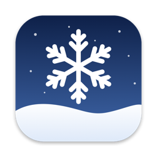

<p align="center">
  
</p>

<h1 align="center">Sugrob</h1>

<p align="center">
  Снег на рабочем столе Mac, который по-настоящему копится.<br>
  <a href="README.md">English version</a>
</p>

<!-- Место для демо-GIF: запишите ~10 с того, как снег оседает и смахивается, сохраните как
     docs/demo.gif (≤ 5 MB) и раскомментируйте блок ниже.
<p align="center">
  
</p>
-->

**Sugrob** — крошечное приложение для строки меню: поверх всего экрана идёт снег. Снежинки
оседают на верхних краях окон и на Dock, а осевший снег ведёт себя как снег:

- **уменьшите окно** — снег за новым краем осыплется;
- **сдвиньте окно** — снег не поедет вместе с ним, а соскользнёт; от резкого рывка он слетит;
- **проведите курсором** по сугробу — он рассыплется на падающие комочки;
- **смахните снег с Dock** курсором;
- снег, упавший с одного окна, приземляется на окно ниже и **копится там**.

## Без разрешений и без сети

Это главная особенность, а не сноска.

- **Никаких запросов разрешений.** Sugrob не нужны ни Screen Recording, ни Accessibility,
  ни Input Monitoring. Он читает только *положение* окон (никогда не заголовки и не
  содержимое) и положение курсора — macOS разрешает это любому приложению.
- **Вообще никакой сети.** Ни телеметрии, ни аналитики, ни проверки обновлений. Приложение
  не открывает ни одного соединения; CI на каждом коммите проверяет, что в коде нет сетевых API.
- **Никогда не мешает.** Слой со снегом полностью игнорирует мышь: клики проходят насквозь к
  тому, что под ним. Нет иконки в Dock, нет в ⌘-Tab, никогда не забирает фокус.
- **Лёгкий.** Около 3% CPU во время снегопада на Apple Silicon и ноль в паузе. Сам
  останавливается, когда экран заблокирован или спит, во время заставки, в Mission Control,
  на дисплеях с полноэкранным приложением и (по желанию) от батареи.

## Установка

1. Скачайте `Sugrob-x.y.z.dmg` из [последнего релиза](../../releases/latest).
2. Откройте его и перетащите **Sugrob** в **Программы** (Applications).
3. Запустите. В строке меню появится снежинка.

> [!IMPORTANT]
> Релизные сборки не подписаны Apple Developer ID, поэтому при первом запуске macOS скажет,
> что приложение «не может быть открыто, так как Apple не может проверить его на наличие
> вредоносного ПО». Чтобы всё равно открыть, сделайте **одно** из двух:
> - правый клик (или Control-клик) по Sugrob в Программах → **Открыть** → **Открыть**;
>   на macOS 15+, если кнопки «Открыть» нет, зайдите в **Системные настройки →
>   Конфиденциальность и безопасность**, прокрутите вниз и нажмите **Всё равно открыть**;
> - или выполните в Терминале:
>   ```sh
>   xattr -dr com.apple.quarantine /Applications/Sugrob.app
>   ```
>
> Это нужно сделать один раз. Если не хотите доверять готовому бинарнику, [соберите из
> исходников](#сборка-из-исходников) — это займёт минуту.

Нужна macOS 14 Sonoma или новее, Apple Silicon или Intel.

## Настройки

Нажмите на снежинку в строке меню:

| Пункт меню | Что делает |
|---|---|
| **Snow** | Включить или выключить снег. Когда выключен, снежинка тусклая. |
| **Intensity** | Light, Medium или Blizzard — слабый, средний или метель. |
| **Snow on Windows** / **Snow on Dock** | Где оседает снег. |
| **Clear All Snow** | Сбросить всё, что накопилось. |
| **Settings…** (⌘,) | Окно настроек, см. ниже. |

В окне настроек дополнительно:

- **Максимальная высота сугроба** (6–20 pt) и **ветер** (от штиля до 2×).
- **Частота кадров:** *Balanced* (30 fps в покое, 60 fps, пока летит снег; по умолчанию),
  *Smooth* (всегда 60 fps, примерно вдвое больше CPU) или *Efficient* (не выше 30 fps).
- **Пауза от батареи.**
- **Запуск при входе в систему.**
- **Точное определение Dock** (по умолчанию выключено). Sugrob вычисляет размер Dock по его
  настройкам, и обычно это точно. Если снег лежит чуть шире или уже Dock, эта опция измерит
  его через Accessibility; macOS попросит это разрешение только при включении опции.

Всё применяется сразу.

## Сборка из исходников

Нужны macOS 14+ и Swift 6: Xcode 16+ или только Command Line Tools
(`xcode-select --install`).

```sh
git clone https://github.com/Olzhiro4ka/Snow.git
cd Snow
make test     # юнит-тесты симуляции
make run      # собирает build/Sugrob.app (debug) и запускает
make app      # релизный универсальный (arm64 + x86_64) build/Sugrob.app
make dmg      # build/Sugrob-<версия>.dmg и .zip
```

Скопируйте `build/Sugrob.app` в `/Applications`. Собранное самостоятельно приложение не
попадает в карантин и открывается без танцев с Gatekeeper.

Полезные флаги запуска для разработки (`make run ARGS="--hud --debug-surfaces"`):

| Флаг | Эффект |
|---|---|
| `--hud` | fps, время кадра, число частиц, CPU и память |
| `--debug-surfaces` | обводит найденные окна, их верхние края и Dock |
| `--instant-snow` | сразу полные сугробы (для скриншотов) |
| `--seed N` | детерминированная случайность |
| `--fps N` | фиксированная частота кадров |
| `--precise-dock` | измерение Dock через Accessibility на этот запуск |
| `--settings` | открыть окно настроек при запуске |

## Как это устроено

На каждом дисплее чуть выше Dock лежит одно прозрачное окно, сквозь которое проходят клики.
Положения окон берутся из `CGWindowListCopyWindowInfo`: несколько раз в секунду, не на
главном потоке. Снег на крае каждого окна — небольшая карта высот с физикой угла естественного
откоса. Всё рисуется Metal за один проход. Симуляция лежит в `Sources/SnowCore`, не зависит от
UI и покрыта юнит-тестами. Подробные заметки по архитектуре — в [CLAUDE.md](CLAUDE.md).

## Участие

Баг-репорты и pull request'ы приветствуются, см. [CONTRIBUTING.md](CONTRIBUTING.md).
Два жёстких правила: никакой сети и никаких запросов разрешений в конфигурации по умолчанию.

## Лицензия

[MIT](LICENSE)
